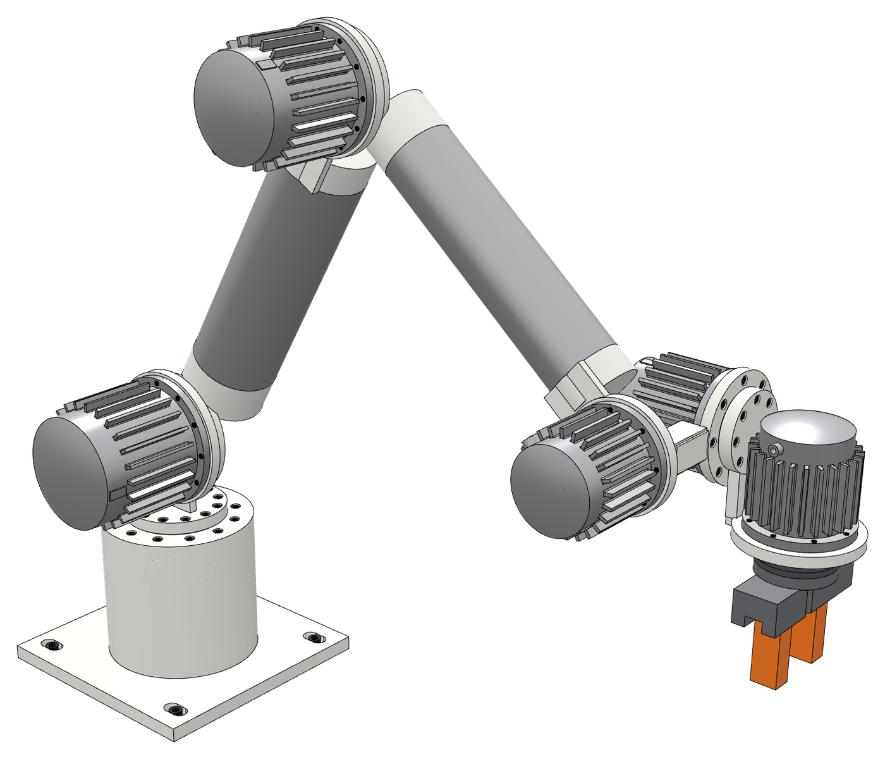
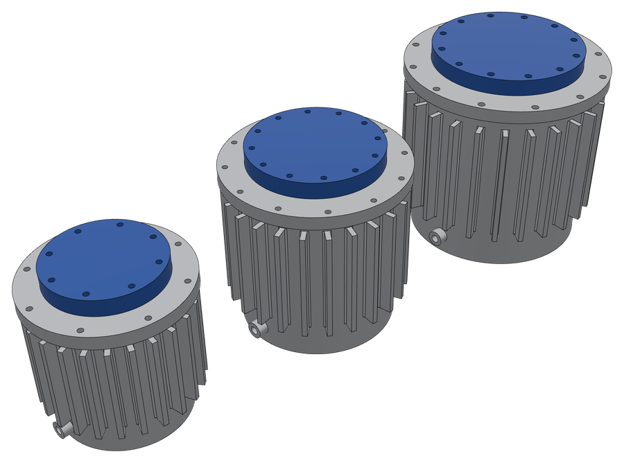
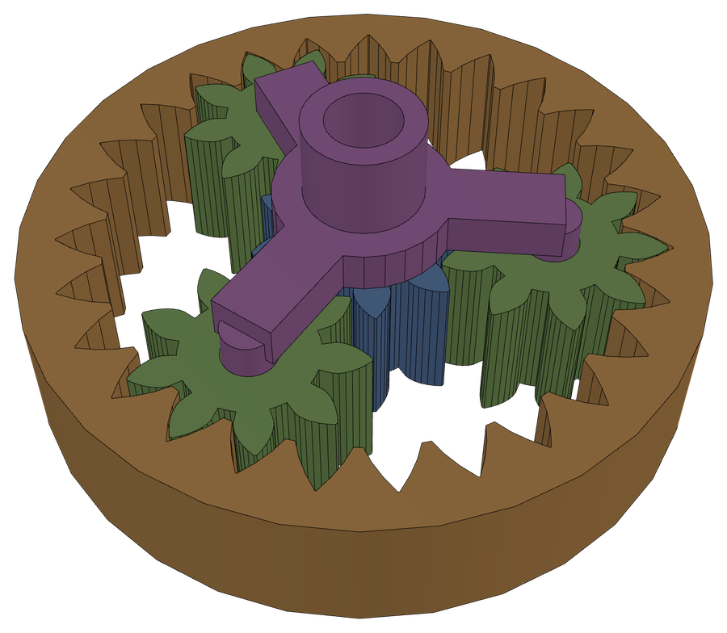
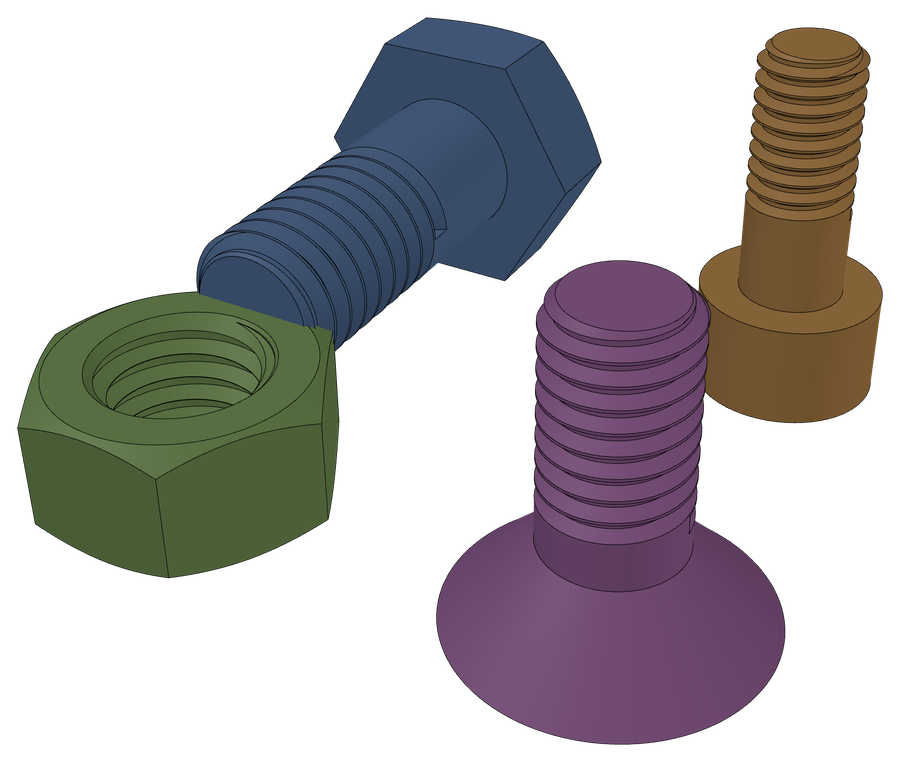
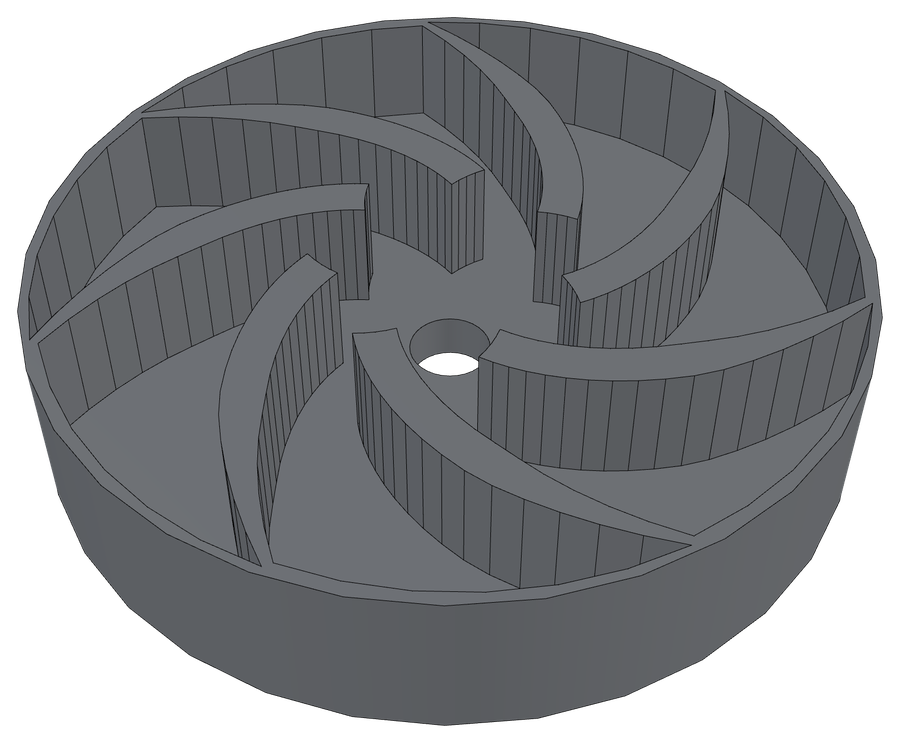
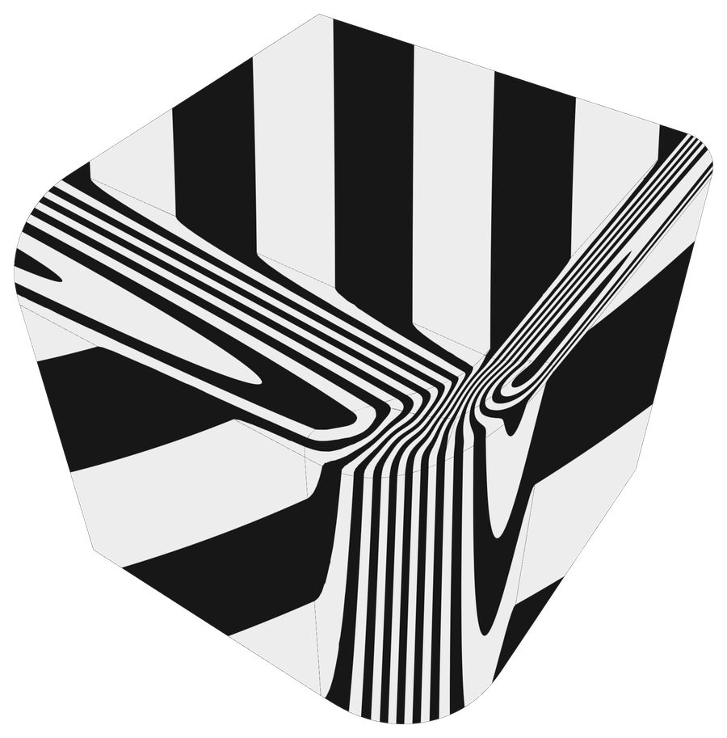
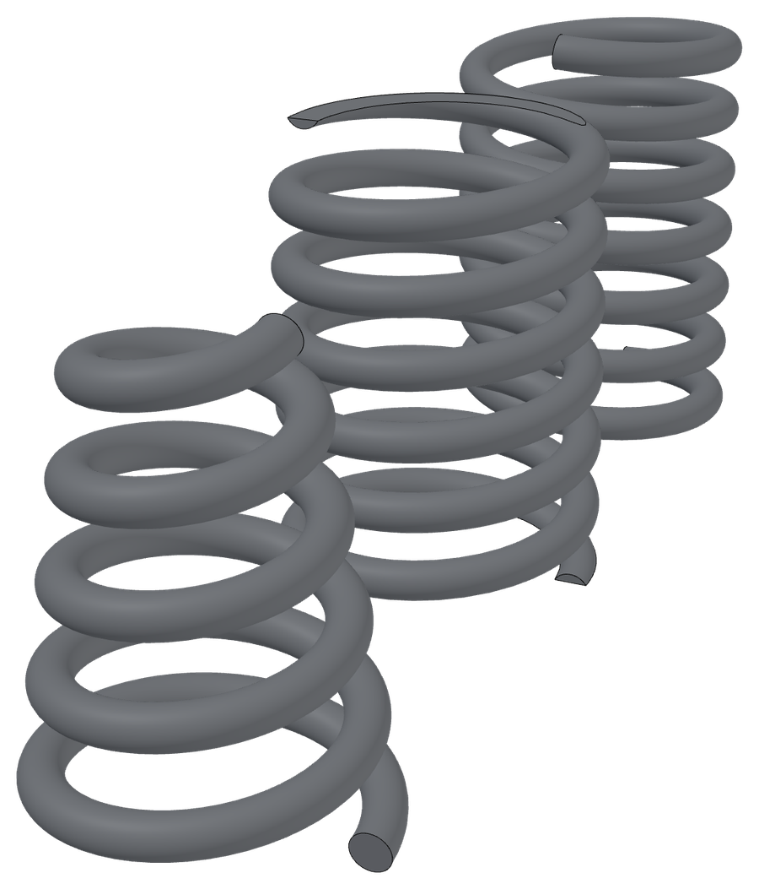

# popkern

**A CAD kernel for everyone who makes things.**

popkern is an open-source parametric boundary representation (BRep) CAD
kernel written in Rust. In plain terms, it's the math that builds and
edits precise solid models, plus accessible ways to use that math. You
build parts with short scripts, backed by research-class CAGD
algorithms, with live script editing in the browser and MCP support for
your agents.

It's free forever, and I'm aiming to make it one of the best kernels
available.

[Try it in your browser](https://popkern.dev/live/) ·
[Install](https://popkern.dev/install/) ·
[Read the launch post](https://popkern.dev/blog/announcing-popkern.html) ·
[Discord](https://discord.gg/38p9xBBwff) ·
[Support popkern](https://popkern.dev/support/)



## Made with popkern

Every one of these is an example in popkern live, rendered there. Open
one and the same script builds the same model in your browser. Each
had to be proven watertight to ship.

| | |
|---|---|
|  |  |
| **Cycloidal joints.** The arm's three joint sizes, each a motor driving a cycloidal reducer: discs, ring pins, output pins and a cross-roller bearing. | **Planetary gearbox.** A 4:1 set as an assembly. Every involute tooth is computed in the script. |
|  |  |
| **Real threads.** An M6 bolt and nut, a cap screw and a countersunk screw, modelled to ISO spec rather than faked with a texture. | **Centrifugal impeller.** Seven backswept blades carved by one star-shaped cut whose spiral walls the script computes. |
|  |  |
| **Smooth where rounds meet.** Three different radii closing on one corner. The zebra stripes flow through unbroken, thanks to a certified curvature-continuous cap. | **Three springs from one verb.** Compression, tapered and left-hand springs, each swept along an exact helix. |

## Parts are scripts

Every popkern part is a short [Rhai](https://rhai.rs/) script. Rhai is
a small, friendly scripting language. You get the same part running a
script in your browser or on your machine.

Bigger parts grow as projects. A project is a folder of numbered
migration scripts, each picking up where the last one left off, much
like database migrations. A later step can reach back and change an
earlier feature, and the history scrubber replays the part one step at
a time. Projects are git friendly, and `popkern build` turns one into a
`.pkn` document or a STEP file from the command line.

```rhai
// boss_plate/migrations/001_plate.rhai
let m = model();
m.profile(xy()).rect(2.4, 1.6)
    .sketch("plate_sketch").extrude(blind(0.4));
m

// boss_plate/migrations/002_boss.rhai
let m = previous();
let boss = m.tool(|m| m.profile(xy_at(0.2))
    .circle(0.35).sketch("boss_sketch").extrude(blind(0.8)));
m.active().union(boss);
m

// boss_plate/migrations/003_rounds.rhai
let m = previous();
m.active().fillet(edges().between("cylinder", "plane"),
    0.08, #{ label: "rounds" });
m
```

The [scripting guide](docs/reference/scripting-guide.md) covers the
whole surface.

## Getting started

The quickest way to start is [popkern live](https://popkern.dev/live/)
in your browser, with nothing to install.

To run it on your own machine, with the full power of your computer
behind it:

```sh
# macOS and Linux
curl -fsSL https://popkern.dev/install.sh | sh
```

```powershell
# Windows (PowerShell)
irm https://popkern.dev/install.ps1 | iex
```

Want to read the scripts before you run them? Good instinct! They're
in this repo under [`web/lander/`](web/lander/install.sh).

Then make a project and start popkern live on your projects folder:

```sh
popkern new my-parts/bracket
popkern serve my-parts
```

Open http://127.0.0.1:7690 and start building. Everything stays on your
machine. If you'd rather stay on the command line,
`popkern run part.rhai --step part.step` builds a script straight to a
STEP file.

### Using an AI agent?

`popkern serve` also runs an MCP server, so your agent can list, edit,
build and export the same projects you're working on. For Claude Code:

```sh
claude mcp add --transport http popkern http://127.0.0.1:7690/mcp
```

### Building from source

The toolchain is pinned in `rust-toolchain.toml`, so rustup picks the
right one for you.

```sh
cargo build --release -p popkern-cli   # the popkern command
tools/build-live.sh --web               # popkern live's wasm bundle, for popkern serve
```

The kernel itself is a set of crates under `crates/`, if you'd rather
build on it directly. [`AGENTS.md`](AGENTS.md) has the crate map, the
dependency rules and the quality gates every change has to pass.

## What works today

Quite a lot, actually!

- **Booleans** on exact solids. They're transactional, so an operation
  either works completely or fails cleanly without leaving you a
  half-broken part.
- **Fillets and chamfers**, chains of them too. Corners where three or
  more fillets meet get smooth patches (G² where the geometry allows
  it) or mitres.
- **Sweeps, revolves and lofts**, shelling and offsets, and thickening
  an open sheet into a solid.
- **Sketches** with a 2D constraint solver, and a solved sketch turns
  straight into a body.
- **Watertight tessellation**, and **STEP** in and out,
  checked against OpenCASCADE in testing.
- **A full feature tree.** Roll back, suppress and reorder features,
  undo and redo, and your selections keep pointing at the right faces
  and edges after a rebuild.
- **Assemblies, threads, fasteners and hinges.**
- **Structural and thermal simulation** right in popkern live. Pick the
  faces to hold and load, pick a material, and see stress, deflection
  and safety factors on your part in seconds.

Every render in the gallery comes out of the test suite. They have to
pass kernel validation, a watertight tessellation check and a STEP
round trip before they count.

## What doesn't work yet

Plenty. This is experimental software! Hardening has only
just begun, some poor architecture choices have been allowed to
persist, there's unoptimized code all over, and loads of features you
might expect probably don't exist yet.

Complex parts can be slow to build. Some shapes still fail, including
certain arrangements of holes cut through a part, fillets that run into
other fillets at awkward corners, and curved surfaces that nearly
touch. Other things will certainly break too.

Where the kernel declines, it's supposed to decline loudly and tell you
the numbers. If it ever fails quietly, that's a bug and I want to hear
about it!

Next up: adding non-manifold topology to booleans is my top priority,
along with more exact geometry cases, more fillet special cases and
kinds, and improved surface healing. Fuzz testing booleans, fillets and surface healing will be a
big focus soon too.

## Agent-built, test-verified

Every line of popkern was guided by me, but written by AI agents.

Nothing an agent writes is trusted on its own. Every change has to pass
thousands of automated tests and the kernel's own validation before
it's committed, and results are cross-checked against OpenCASCADE
wherever the two can be compared. When an operation can't produce a
valid solid, it declines and says why, rather than handing back
something broken.

I know not everybody is on board with AI usage, and that
conversation is worth having. The
[launch post](https://popkern.dev/blog/announcing-popkern.html) says
more about why I'm doing this and how.

## Come and break it

Early is the useful time to arrive! The most valuable thing anyone can
do right now is throw a part at popkern that it can't build and
[open an issue](https://github.com/popkern-dev/popkern/issues). It
becomes a test case.

Other ways to help:

- **Star the repo.** It helps more people find popkern.
- **Use it.** Build a part, then tell people it exists.
- **Join the [Discord](https://discord.gg/38p9xBBwff).** Ask questions,
  share what you build, and talk shop.
- **Chip in.** popkern is free, but it isn't free to make. Most of the
  cost is agent time. [GitHub Sponsors](https://github.com/sponsors/popkern-dev)
  or [Ko-fi](https://ko-fi.com/popkerndev) both go straight back into
  the kernel.
- **Follow along** on [Bluesky](https://bsky.app/profile/popkerndev.bsky.social),
  [X](https://x.com/popkerndev) and [Reddit](https://www.reddit.com/user/popkerndev).
- **Pass it on** to anyone who makes things.

## License

What you make with popkern is yours, full stop.

popkern is licensed under the **GNU Affero General Public License v3.0
only** ([`LICENSE`](LICENSE)) **with an additional permission**
([`LICENSE-EXCEPTION`](LICENSE-EXCEPTION)) for user scripts and
produced geometry. The AGPL keeps improvements to the kernel open; the
exception covers everything you make with it.

### Licensing FAQ

**Do I have to publish scripts I write against popkern?** No. Part
scripts, Rhai/Python scripts, `.pkn` documents and migrations that use
popkern's published APIs are *User Scripts* under `LICENSE-EXCEPTION`:
they are not covered works, and they are excluded from the
Corresponding Source you would otherwise have to offer. License them
however you like.

**Who owns the models, meshes and STEP files popkern produces?** You
do. Output of any kind, produced locally or by a service you run, is
not a covered work and popkern's copyright holders claim no rights in
it.

**I run popkern behind a web service. What does AGPL §13 require?**
You must offer users of that service the Corresponding Source of the
*popkern* you run — including any changes you made to the kernel —
not your scripts, not your models.

**I modified the kernel / I ship a program that links popkern.** The
popkern portion stays AGPL: convey its source (with your kernel
modifications) as the license requires. Your own scripts are still
excluded by the exception. The exception is deliberately not a
Classpath-style linking exception — the kernel is copyleft; your work
on top of it is yours.

**Third-party dependencies.** Every crate in the dependency graph is
under a permissive license (see `THIRD-PARTY-NOTICES.md`, regenerated
by `cargo about generate`); `deny.toml` enforces the allowlist in CI.
See `docs/decisions/2026-08-30-user-scripts-and-output-license-exception.md`.
